  
  
  
  
  

## About me

> [!IMPORTANT]
> Hey, I'm **Saksham** 👋
>
> I'm a B.Tech **Software Engineering** student at **Delhi Technological University (DTU)**, class of 2029, with an **8.8 CGPA**. I gravitate toward the unglamorous parts of software: the parts that have to keep working when the network doesn't, the data is messy, and the stakes are real.
>
> Lately that means [HireFlow](https://hireflow-three-woad.vercel.app), an agent that finds internships and fills applications in a real browser; [AGEX](https://github.com/saksham-eng560/agex), an open-source multi-agent orchestrator for Claude Code; the Android app for our [Smart India Hackathon](https://github.com/saksham-eng560/SIH-26168) dead-reckoning system; and a [Gemma-powered maternal-health assistant](https://github.com/saksham-eng560/Gemma-4-AI-Maternal_Health_App) for rural health workers. Underneath it all is a steady competitive-programming habit in **C++** and a growing focus on **backend engineering, scalable systems and DevOps**.
>
> I'm **open to SDE, backend and AI/ML internships**. If you like what I build, [reach out](mailto:sakshamverma56000@gmail.com).

## 🛠 Tech stack

**Languages**

**Backend, data & web**

**AI & machine learning**

-0a100c?style=flat-square&logo=google&logoColor=4285F4)

**Mobile**

**Cloud, DevOps & tools**

## 🚀 Things I've built

<table>
<tr>
<td width="50%" valign="top">

### [HireFlow](https://hireflow-three-woad.vercel.app) &nbsp;·&nbsp; AI agent
Swipe right on a job, and it applies. Scans Greenhouse, Lever, Ashby, Workday and **107 startup career sites**, scores matches 0–100, tailors the resume, writes the cover letter and fills the form in a real browser, then waits for approval.

`FastAPI` `Next.js` `PostgreSQL + pgvector` `Celery` `Redis` `Playwright`

**111** endpoints · **474** tests · **81%** coverage · **12/12** benchmark applications
 [Live app](https://hireflow-three-woad.vercel.app) · [Source (TinyFish edition)](https://github.com/saksham-eng560/TinyFish)

</td>
<td width="50%" valign="top">

### [AGEX](https://github.com/saksham-eng560/agex) &nbsp;·&nbsp; open source
Turns Claude Code into a **12-agent engineering team** behind one `/agex` command: planner, architect, coder, tester, reviewer, security auditor and more, with typed hand-offs, parallel work units and circuit-breaker feedback loops.

`Claude Code` `Multi-agent` `Python` `Bash` `PowerShell`

Least-privilege tools per agent · installers for macOS, Linux, Windows
 [Source](https://github.com/saksham-eng560/agex)

</td>
</tr>
<tr>
<td width="50%" valign="top">

### [Dead Reckoning for GNSS-denied vehicles](https://github.com/saksham-eng560/SIH-26168) &nbsp;·&nbsp; SIH 2026
Keeps a vehicle on the map when GPS drops out in tunnels. I built the team's **Android operator app**: a foreground sensor service streaming IMU data at **125 Hz** into an Invariant EKF, with a live OpenStreetMap track and uncertainty radius.

`Kotlin` `Jetpack Compose` `Material 3` `osmdroid`
 [Source](https://github.com/saksham-eng560/SIH-26168)

</td>
<td width="50%" valign="top">

### [Maternal Health AI](https://github.com/saksham-eng560/Gemma-4-AI-Maternal_Health_App) &nbsp;·&nbsp; Gemma 4 Good
Voice-first maternal risk triage that works where the internet doesn't. Gemma E2B **on-device** (LiteRT) + E4B on a server (Ollama), Whisper ASR and function calling, guarded by a multi-layer **anti-hallucination engine**.

`Flutter` `Gemma` `LiteRT` `Whisper` `FastAPI`
 [Source](https://github.com/saksham-eng560/Gemma-4-AI-Maternal_Health_App) · [Demo video](https://youtu.be/qY21dcE8Qlo) · [APK](https://github.com/saksham-eng560/Gemma-4-AI-Maternal_Health_App/releases/tag/v1.0)

</td>
</tr>
<tr>
<td width="50%" valign="top">

### [Black Hole Ray Tracer](https://github.com/saksham-eng560/blackhole_simulator) &nbsp;·&nbsp; C++17
Real-time general-relativistic rendering in the terminal: null geodesics through Schwarzschild spacetime with **RK4**, Doppler-beamed accretion disk, multithreaded at 60 FPS in ANSI truecolor.

`C++17` `CMake` `std::thread`
 [Source](https://github.com/saksham-eng560/blackhole_simulator)

</td>
<td width="50%" valign="top">

### [Keyline API Key Vault](https://github.com/saksham-eng560/api-manager) &nbsp;·&nbsp; backend
Encrypted vault for API keys: OAuth2/JWT auth, **Fernet** encryption at rest, PBKDF2 password hashing, per-user REST endpoints over PostgreSQL.

`FastAPI` `SQLAlchemy` `PostgreSQL` `JWT`
 [Source](https://github.com/saksham-eng560/api-manager) · [Live](https://api-manager-p192.onrender.com/)

</td>
</tr>
</table>

<b>More projects</b>

 

| Project | What it does | Stack |
| --- | --- | --- |
| [AxisIQ Control Tower](https://github.com/saksham-eng560/supply-chain-google-solution) | Live supply-chain risk scoring and condition-aware rerouting from weather, traffic and hazard feeds (Google Solution Challenge) | FastAPI · Leaflet · Docker · Gemini |
| [Jaltaranga](https://github.com/saksham-eng560/jaltaranga) | Flood forecasting and evacuation routing that avoids submerged roads (WeMakeDevs × AWS) | Python · AWS SAM · Bedrock · Polly |
| [Viveka](https://github.com/saksham-eng560/viveka) | Private, on-device focus companion for macOS with a local LLM | TypeScript · Python · Swift |
| [Player Movement Heatmaps](https://github.com/saksham-eng560/Synapse-HeatMap-Model) | YOLOv8 player tracking turned into per-player and team heatmaps | YOLOv8 · OpenCV · Pandas |
| [Academic Lens](https://github.com/saksham-eng560/Final-DS-project-Management) | Results dashboard on hand-written BSTs, heaps and merge sort | FastAPI · SQLAlchemy |
| [DSA Music Player](https://github.com/saksham-eng560/Music-Player) | Music player whose playlist is a doubly linked list | FastAPI · JavaScript |
| [DSA_PRAC](https://github.com/saksham-eng560/DSA_PRAC) | My C++ data-structures and algorithms practice | C++ |

## 🏆 Achievements & programs

- 🥇 **Top 5** at Synapse Hackathon &nbsp;·&nbsp; **Rank 9** at AIMS Hackathon
- 🌱 **Active Contributor**, GirlScript Summer of Code 2026
- 🛰️ Smart India Hackathon 2026 &nbsp;·&nbsp; 🌍 Google Solution Challenge 2026 &nbsp;·&nbsp; 💗 Gemma 4 Good &nbsp;·&nbsp; ☁️ WeMakeDevs × AWS Bharat Builds Tour
- 🧠 LeetCode badges: **100 Days 2026**, **50 Days 2026**, **Top SQL 50**

## 🧩 Problem solving

## 📈 GitHub activity

  
  

  

<picture>
  <source media="(prefers-color-scheme: dark)" srcset="https://raw.githubusercontent.com/saksham-eng560/saksham-eng560/output/snake-dark.svg">
  <source media="(prefers-color-scheme: light)" srcset="https://raw.githubusercontent.com/saksham-eng560/saksham-eng560/output/snake-light.svg">
  
</picture>

## 📫 Let's connect

  
  
  
  
  
  

📍 Delhi, India
